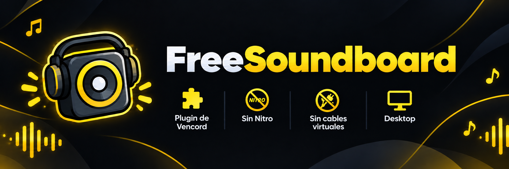

<div align="center">

<p>
  <b><a href="README.md">ESPAÑOL</a></b> &nbsp;•&nbsp; <b><a href="README.en.md">ENGLISH</a></b>
</p>



<br/>
<br/>

**Play Discord Soundboard sounds from any server in your voice calls without Discord Nitro or virtual audio cables.**

*A Vencord userplugin compatible with Discord Desktop. Ported from the concept by [YashRajCodes](https://github.com/YashRajCodes/soundboardPermissionsBypass.web).*

<br/>

[](https://vencord.dev)
[](https://www.typescriptlang.org/)
[](https://github.com/AstroLopitecus123/FreeSoundboard-Vencord)

</div>

---

## Features

| Feature | Description |
| :--- | :--- |
| **Nitro Soundboard Bypass** | Unlock and play sounds from any server or locked sound without needing a Discord Nitro subscription. |
| **Native Audio Mixer (Web Audio API)** | Injects and mixes soundboard audio directly into your microphone stream in real time with zero latency or distortion. |
| **Quick In-Call Controls (Right-Click)** | Sliders directly on your user context menu in voice calls to adjust microphone gain (up to 300%) and soundboard volume (0% to 200%). |
| **Screen & App Share Loopback** | Stereo loopback audio capture and video streaming optimized in Electron without freezes or black screens. |
| **Zero Virtual Cables** | No need to install VB-Audio Cable, VoiceMeeter, or configure secondary virtual audio devices on Windows/Linux/macOS. |
| **Automatic Memory Cleanup** | Immediate disposal of audio nodes, streams, and timeouts upon sound completion (*zero memory leaks*). |

---

## Plugin Structure

```text
FreeSoundboard/
├── assets/
│   └── banner.png  # Plugin banner
├── index.tsx       # UI, WebRTC/Audio patches, context menu and Flux event handlers
├── native.ts       # Electron support for screen capture and native audio loopback
├── README.md       # Spanish documentation
└── README.en.md    # English documentation
```

---

## Installation

### Step 1: Copy to Vencord
Copy the `FreeSoundboard` folder into the `src/userplugins/` directory of your Vencord repository:
```text
Vencord/
 └── src/
      └── userplugins/
           └── FreeSoundboard/
```

### Step 2: Build & Inject
Open a terminal in the root of the Vencord folder and run:
```bash
pnpm build
pnpm inject
```

### Step 3: Enable the Plugin
1. Open Discord.
2. Go to **User Settings** > **Vencord** section > **Plugins**.
3. Toggle on **`FreeSoundboard`**.

---

## How to Use

1. **Playing Sounds:** Join any voice channel or call and open Discord's regular Soundboard panel. All sounds (even locked ones or from other servers) are ready to play.
2. **Live Volume Adjustment:** Right-click your own user profile or avatar in a voice call to access the **Sounds & Microphone** submenu:
   - **Voice Volume (Microphone):** Boost your mic gain from 50% to 300% (useful if your mic input is too quiet).
   - **Sound Volume (Soundboard):** Adjust the output volume heard by other participants in the call (0% to 200%).

---

## Settings

From **User Settings** > **Plugins** > **FreeSoundboard** settings icon, you can configure:

| Setting | Options / Range | Description |
| :--- | :--- | :--- |
| **Bypass Mode** | `Smart` (Recommended) / `Always` | In Smart mode, bypasses only in servers where you lack permissions or Nitro; in Always mode, routes all sounds through the local mixer. |
| **Voice Volume (Microphone)** | `50%` to `300%` (Default: 200%) | Hardware input boost level handled natively via Web Audio API. |
| **Transmit Volume** | `0%` to `200%` (Default: 100%) | Output gain level with which soundboard effects are mixed into the call. |

---

## Credits

* **Original concept:** [YashRajCodes](https://github.com/YashRajCodes/soundboardPermissionsBypass.web)
* **Port:** [AstroLopitecus123](https://github.com/AstroLopitecus123).
